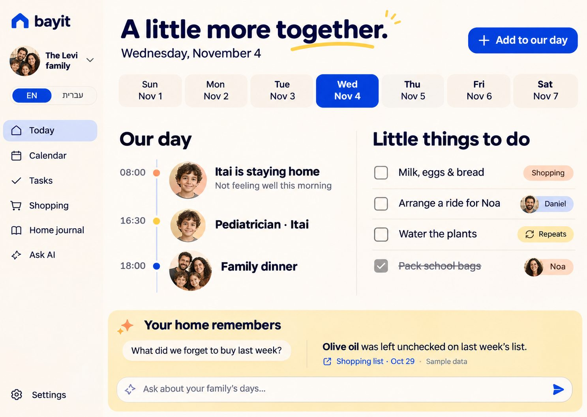
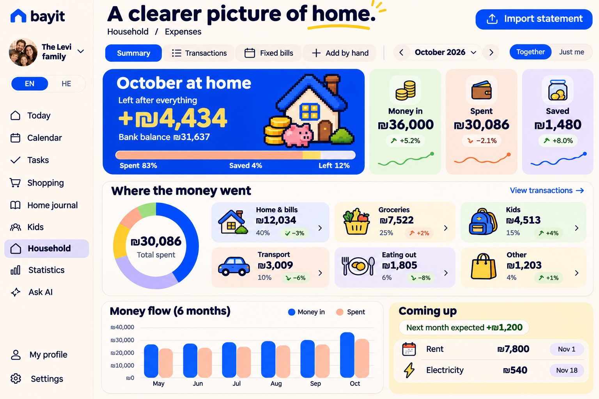
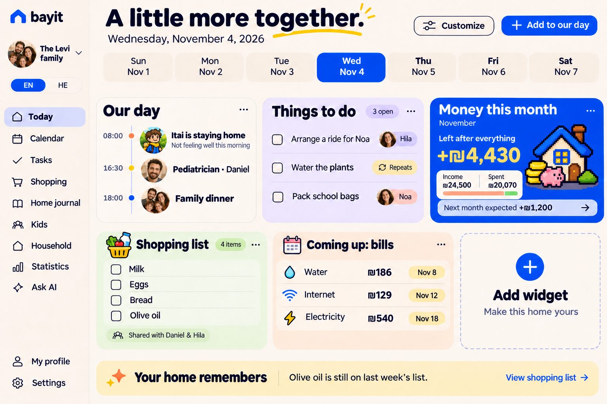
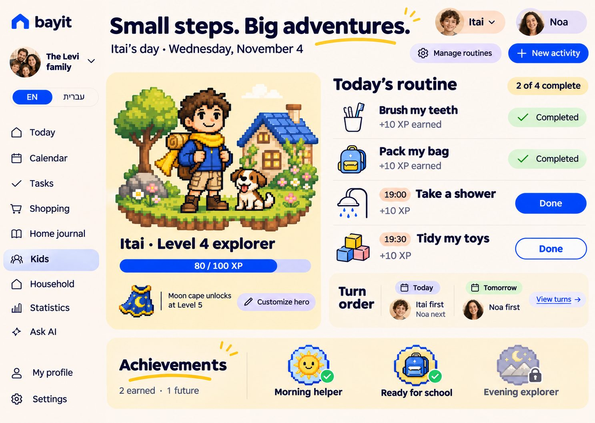
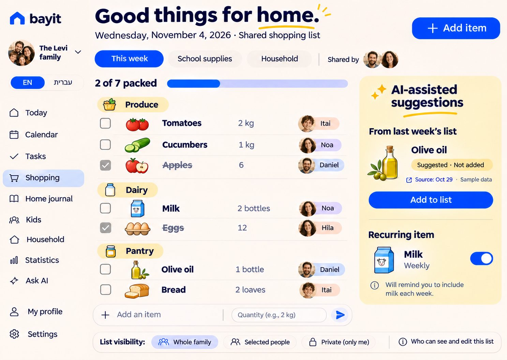
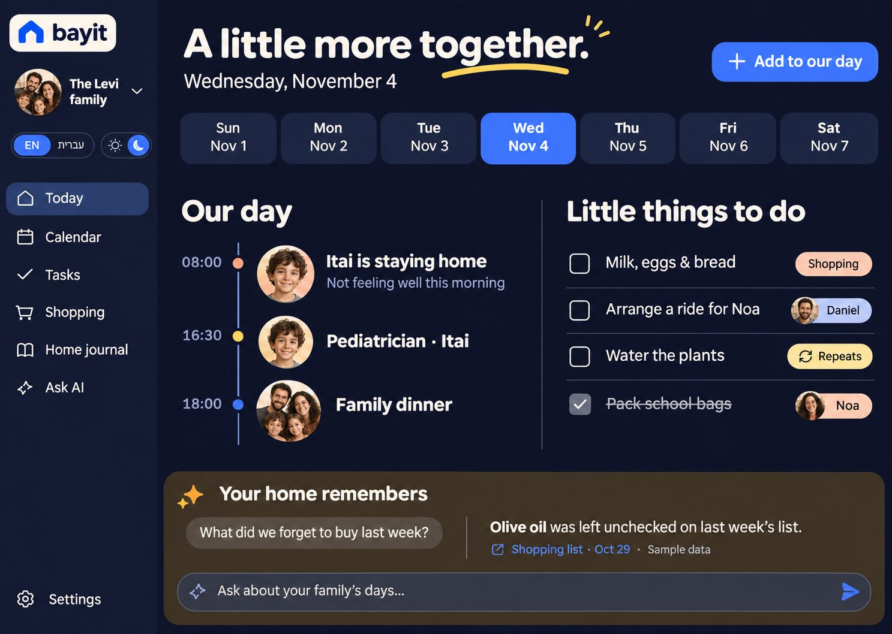

<p align="center">
  
</p>

<h1 align="center">Bayit · בית</h1>

<p align="center"><b>A warm, bilingual family home app: your day, tasks, shopping, kids, money and memories in one place.</b><br>
Hebrew (RTL) and English (LTR) · light and night · phone, tablet and desktop · self-hosted on your own Cloudflare account.</p>

<p align="center">
  <a href="https://frenkelsergei-blip.github.io/bayit/">Website</a> ·
  <a href="docs/self-hosting.md">Self-host it</a> ·
  <a href="docs/extending.md">Extend it</a> ·
  <a href="LICENSE">MIT license</a>
</p>

<p align="center"></p>

## What it does

| | |
| --- | --- |
| **Today** | Your family's day in customizable widgets: agenda, tasks, shopping, notes, money this month, upcoming bills, and an AI question box. |
| **Calendar** | Week, agenda and month views, with each member's color and portrait, and repeating events. |
| **Tasks & routines** | Tasks with owners, routines for kids with weekdays, times, rewards, approvals and turn-taking. |
| **Shopping** | Multiple lists, categories, quantities and units, history-based suggestions, and lists that move from trip to trip. |
| **Kids** | Pixel characters, XP and achievements, a wardrobe (cap and moon cape), and turn history. |
| **Household** | Meals and pantry, **Expenses**, maintenance, and documents (files in private storage). |
| **Expenses** | Import **Bank Leumi** and **Max** statements (PDF), or connect **[RiseUp](docs/riseup.md)** (optional) to read transactions daily. Every total is checked against the statement, and card payments are never counted twice. You get income vs. spending, categories with drill-down, recurring bills, a next-month forecast and optional AI tips. |
| **Ask AI** | Your choice of AI (**Claude, OpenAI/Codex, Gemini, Grok**, or any OpenAI-compatible service) answers questions from records you're allowed to see and prepares changes. **Nothing is saved until you tap Apply**, and Undo is available. |
| **Telegram** | Your own family bot: reminders with Done and Snooze buttons, a morning summary, parent approvals, and chat with your AI. It understands text, **photos** and **voice messages**, and accepts statement PDFs. |
| **Privacy** | Every note, task and event has an owner and visibility (private, family, or selected people). The server enforces it, and AI, reminders, statistics and widgets follow the same rules. |

<p align="center">
  
  
</p>
<p align="center">
  
  
  
</p>

## How it works

```
Browser (React + Vite) ──► Cloudflare Pages ──► Pages Function (app/cloud/worker.mjs)
                                                 ├── D1      households, records, money, Telegram links
                                                 ├── R2      private documents
                                                 ├── Workers AI (optional) voice transcription
                                                 ├── AI provider: Claude, OpenAI, Gemini, Grok or custom (each household's own key)
                                                 └── Telegram Bot API (each household's own bot)
Cloudflare Worker "bayit-reminders" (cron, every minute) ──► /api/internal/reminders
```

- **One installation, many households.** Each person signs in with Google. A parent creates a household and invites others with single-use links.
- **Each installation brings its own credentials.** Cloudflare account, Google OAuth client, AI key and Telegram bot belong to whoever runs it. Keys are encrypted with AES-GCM on the server and never returned to the browser.
- **Fictional demo mode:** open `/?demo=1` to explore with a sample family. Nothing is saved.

## Quick start (local demo)

```bash
cd app
npm install
npm run dev -- --host 127.0.0.1 --port 4173
```

Open <http://127.0.0.1:4173/?demo=1>. For the full cloud setup (sign-in, sharing, expenses, Telegram), follow **[docs/self-hosting.md](docs/self-hosting.md)**.

**Prefer your own machine or another provider?** Bayit also runs with Docker on a home computer, NAS, Raspberry Pi, free cloud server or VPS. It's the same code, with SQLite and a local folder instead of D1 and R2: `cp .env.example .env && docker compose up -d --build`. See **[docs/self-hosting-docker.md](docs/self-hosting-docker.md)**.

## Make it yours

- **Country settings:** `shared/home-config.mjs` sets the home timezone and currency (Israel and ₪ by default).
- **AI providers:** households pick Claude, OpenAI (Responses API, so Codex models work), Gemini, Grok or a custom OpenAI-compatible URL in Settings → AI. Adapters are in `app/cloud/ai-providers.mjs`, and speech providers are in `app/cloud/speech.mjs`.
- **Banks and cards:** add a statement format in `shared/finance-parse.mjs`. Each parser must reconcile against the totals printed on the statement.
- **Widgets, categories and languages:** see **[docs/extending.md](docs/extending.md)**.

## Project layout

```
app/               React client (src), Cloudflare server (cloud), static assets (public)
app/cloud/         API, auth, household state, Telegram, reminders, money, speech
app/cloud/migrations/  D1 schema
shared/            Code used by both the client and the server (AI contract, finance, shopping lists, config)
design-system/     Design tokens, copy (en/he), icon catalog
tests/             Unit tests (node --test); tests/e2e for local end-to-end runs
docs/              Self-hosting, extending, testing, images
site/              The project website (GitHub Pages)
```

## Tests

```bash
cd app && npm run test:domain && npm run test:sites && npm run build:cloud
```

End-to-end runs against a local `wrangler dev` with fake Telegram/Claude/speech APIs are described in [docs/testing.md](docs/testing.md).

## Status and limitations

Bayit is a working family app that's used day to day, and it's still young:
- **Locale:** it's Israel-first (Hebrew/English, ₪). Bank import supports Bank Leumi and Max only so far.
- **Hosting:** Cloudflare (Pages, D1, R2) is the only hosting target so far. A run-anywhere Docker version is planned.
- **Channels:** Telegram is the only messaging channel; WhatsApp and phone push are not built yet.
- **Code layout:** much of the UI is still in one large `app/src/App.jsx`. It's being split up gradually, and contributions are welcome.
- **Data ownership:** whoever operates an installation can technically read its database. Bayit keeps family members' data apart *inside the app*; it is not end-to-end encrypted.

## Contributing

Issues and pull requests are welcome. See [CONTRIBUTING.md](CONTRIBUTING.md) and [AGENTS.md](AGENTS.md) for the product and design rules. Please report security issues privately (see [SECURITY.md](SECURITY.md)).

## License

[MIT](LICENSE) for Bayit's code. Bundled OpenMoji graphics are CC BY-SA 4.0, and the fonts are OFL. See [THIRD_PARTY_NOTICES.md](THIRD_PARTY_NOTICES.md).
