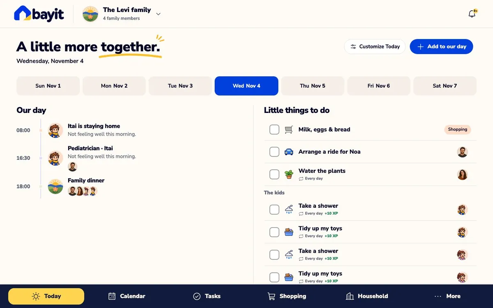
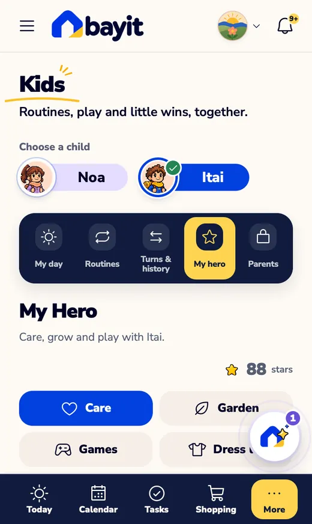
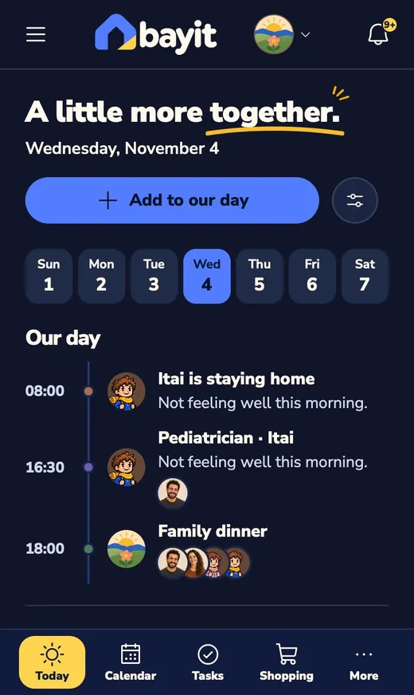

<p align="center">
  <picture>
    <source media="(prefers-color-scheme: dark)" srcset="app/public/assets/brand-selected-20261107/logo-dark-alpha.png">
    
  </picture>
</p>

<p align="center"><b>A warm, bilingual family home app: your day, calendar, tasks, shopping, kids, money and a Telegram bot, in one place.</b><br>
Hebrew (RTL) and English (LTR) · light and night · phone, tablet and desktop · your own installation on Cloudflare or Docker.</p>

<p align="center">
  <a href="https://github.com/frenkelsergei-blip/bayit/actions/workflows/ci.yml"></a>
  <a href="LICENSE"></a>
</p>

<p align="center">
  <a href="https://frenkelsergei-blip.github.io/bayit/">Website and video</a> ·
  <a href="https://bayit-8n0.pages.dev/?demo=1">Live demo</a> ·
  <a href="docs/README.md">Documentation</a> ·
  <a href="docs/self-hosting.md">Install</a> ·
  <a href="CHANGELOG.md">Changelog</a>
</p>

<p align="center"></p>

## What it does

| | |
| --- | --- |
| **Today** | The family's day on one calm page you arrange: agenda, little things to do, overdue and anytime tasks, the kids' routines, shopping, notes, money this month, and an AI question box. |
| **Calendar** | Week, agenda and month views, with each person's colour and portrait, repeating events and optional locations. |
| **Tasks & routines** | Tasks with owners, priorities and up to five reminders each. Kids' routines with weekdays, times, rewards, approvals and turn-taking. |
| **Shopping** | Several shared lists with categories, quantities and units, suggestions from what you usually buy, and lists that move from trip to trip. |
| **Kids · My Hero** | Pixel heroes the kids care for, a garden to grow, games and dress-up, earned with XP from routines. |
| **Household** | Meals and pantry, expenses, insurance, home maintenance, contacts, and private documents. |
| **Journal & My Space** | A family journal and each person's own notes and tasks, with search, filters, tags and privacy per note. |
| **Statistics** | Overview, tasks, calendar, kids, shopping and money, with charts, summary cards and trends. Only the areas your family uses appear, and children never see money. |
| **Expenses** | Import **Bank Leumi** and **Max** statements (PDF), or connect **[RiseUp](docs/riseup.md)** (optional). Every total is checked against the statement, and card payments are never counted twice. You get income vs. spending, categories with drill-down, recurring bills, a next-month forecast and optional AI tips. |
| **Ask AI** | Your choice of AI (**Claude, OpenAI, Gemini, Grok**, or any OpenAI-compatible service) answers from the records you're allowed to see and prepares changes. **Nothing is saved until you tap Apply**, and Undo is available. |
| **Telegram** | Your own family bot. It sends reminders with Done and Snooze, a morning summary, approval requests, and tells you when someone changes something assigned to you. Its **/** menu covers today, tasks, the week, shopping, lists, notes and expenses. In plain words, by text, **photo** or **voice**, it adds, completes, moves or edits things. Every change waits for Apply. |
| **Notifications** | Reminders on phones and computers as well as Telegram, with quiet hours. |
| **Privacy** | Every note, task and event has an owner and a visibility: private, family, or chosen people. The server enforces it, and AI, reminders, statistics and widgets follow the same rules. |

<p align="center">
  
  
  
  
</p>
<p align="center"><sub>Screens show a fictional family.</sub></p>

## Try it

- **In your browser:** open the [live demo](https://bayit-8n0.pages.dev/?demo=1) with a fictional family. Changes stay in your browser only.
- **On your computer, for real:** with [Docker Desktop](https://docs.docker.com/get-started/get-docker/) running,
  ```bash
  git clone https://github.com/frenkelsergei-blip/bayit.git
  cd bayit && cp .env.example .env
  docker compose up -d --build
  docker compose logs bayit     # shows a one-time setup code
  ```
  Open <http://localhost:8080>, choose **Start setting up**, and create your passkey and family. Details: [Run with Docker](docs/self-hosting-docker.md).

## Run your own

Each family (or each installation) runs its own copy with its own accounts. There is no central Bayit server.

| Where | Guide | Good for |
| --- | --- | --- |
| **Cloudflare** (free plan) | [Install on Cloudflare](docs/self-hosting.md) | Families who want phones to work everywhere: no server to look after. About 45 minutes, in a terminal. |
| **Docker** | [Run with Docker](docs/self-hosting-docker.md) | The quickest start on one computer (about 5 minutes). Phones need your own https address. |

**What you'll need:**

| | Required? | Guide |
| --- | --- | --- |
| A Cloudflare account, or a machine with Docker | Yes | above |
| Sign-in | Nothing to set up: passkeys (face, fingerprint or screen lock). Google sign-in is optional | [Google sign-in setup](docs/google-sign-in.md) |
| An AI provider key (Claude, OpenAI, Gemini, Grok or compatible) | Optional | [Connections → AI](docs/connections.md#ai-assistant) |
| A Telegram bot from @BotFather | Optional | [Connections → Telegram](docs/connections.md#telegram-bot) |
| Google Maps keys | Optional | [Connections → Maps](docs/connections.md#google-maps-optional) |
| A RiseUp token | Optional | [RiseUp](docs/riseup.md) |

Then keep it healthy with [Updating and backups](docs/updating-and-backups.md) and [Troubleshooting](docs/troubleshooting.md). All guides are listed in [docs/](docs/README.md).

**Let your AI agent do it.** Open the repository in Claude Code, Codex or another agent that reads skills, and ask "Install Bayit on my Cloudflare", "Run Bayit with Docker on my Raspberry Pi", "Help me connect Telegram", "Is my Bayit set up correctly?" or "Update my Bayit". The [skills](.agents/skills/README.md) follow the same steps as these guides. They never put your keys in files or chat, and they ask before deploying.

## How it works

```
Browser (React + Vite) ──► Cloudflare Pages ──► Pages Function (app/cloud/worker.mjs)
                                                 ├── D1      households, records, money, Telegram links
                                                 ├── R2      private documents
                                                 ├── PDF reader Worker (private) bank statements
                                                 ├── Workers AI or household AI key (optional) voice transcription
                                                 ├── AI provider: Claude, OpenAI, Gemini, Grok or custom (each household's own key)
                                                 └── Telegram Bot API (each household's own bot), Web Push
Scheduler Worker (cron, every minute) ──► /api/internal/reminders
```

With Docker, one Node.js server does all of this, with SQLite and a folder in a data volume (`app/host/`).

- **One installation, many households.** Each person signs in with a passkey (or, optionally, Google). The owner sets up with a one-time setup code, creates a household and invites others with single-use links.
- **Each installation brings its own credentials.** The Cloudflare account or server, the optional Google sign-in client, AI keys and Telegram bots belong to whoever runs it. Keys are encrypted with AES-GCM on the server and never returned to the browser.
- **Fictional demo mode:** add `/?demo=1` to any installation's address to explore with a sample family.

## Make it yours

**Extensions** add one ability to your own Bayit: another bank's statements, another AI provider or speech service, a new screen for something your family keeps track of. Each is a small package next to Bayit's own code, so updates don't break it and removing it puts everything back. Ask your AI agent, for example "Add Mistral as an AI provider to my Bayit". Today this needs an agent or a terminal.

- [Extensions](docs/extensions.md): what exists, how to add, check and remove one, and what happens to your data.
- [Building extensions](docs/building-extensions.md) and [Wanted extensions](docs/extensions-wanted.md), if you want to make one.
- **Country, timezone, currency and language:** the `bayit-localize` skill, or `shared/home-config.mjs`.

## Project layout

```
app/src/           React client
app/cloud/         API, auth, household state, Telegram, reminders, push, money, speech (Workers AI or the household AI key)
app/cloud/migrations/  Database schema
app/host/          Node.js host for Docker (SQLite, file store, built-in scheduler)
app/scripts/       bayit-configure (point at your resources), bayit-doctor (check an installation)
shared/            Code used by both client and server (AI contract, finance, shopping lists, config)
design-system/     Design tokens, copy (en/he), icon catalog
tests/             Unit tests (node --test); tests/e2e for local end-to-end runs
docs/              Guides
site/              The project website (GitHub Pages)
.agents/skills/    Skills for AI coding agents
```

## Tests

```bash
cd app && npm run test:domain && npm run test:sites && npm run build:cloud
```

End-to-end runs against a local server with fake Telegram, AI and speech APIs are described in [docs/testing.md](docs/testing.md).

## Status and limitations

Bayit is a working family app that's used day to day, and it's still young:
- **Locale:** it's Israel-first (Hebrew and English, ₪). Bank import supports Bank Leumi and Max only so far.
- **Channels:** Telegram and web push are the messaging channels; WhatsApp isn't built.
- **Docker:** Telegram voice messages use the household AI key (OpenAI or Gemini); Claude cannot transcribe audio.
- **Code layout:** much of the UI is still in one large `app/src/App.jsx`. It's being split up gradually, and contributions are welcome.
- **Data ownership:** whoever operates an installation can technically read its database. Bayit keeps family members' data apart *inside the app*; it is not end-to-end encrypted.

## Contributing

Issues and pull requests are welcome. Please read [CONTRIBUTING.md](CONTRIBUTING.md) and [AGENTS.md](AGENTS.md) (the product and design rules). Report security problems privately; see [SECURITY.md](SECURITY.md).

## License

[MIT](LICENSE) for Bayit's code. Bundled OpenMoji graphics are CC BY-SA 4.0, and the fonts are OFL. See [THIRD_PARTY_NOTICES.md](THIRD_PARTY_NOTICES.md).
