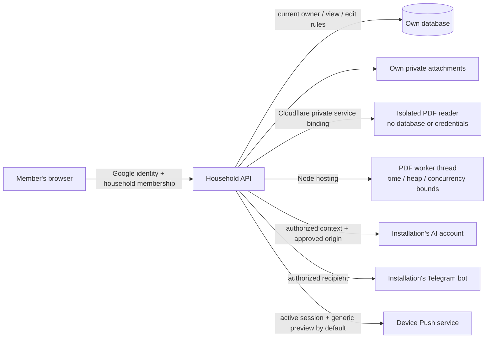

# Security hardening and upgrade guide — 1.18.0

This guide accompanies migration `0009_security.sql`. The original November 6 assessment remains a historical baseline; the remediation report records the changes and verification separately. Each installation owns its resources. No central Bayit database, shared vendor key or telemetry service was introduced.

## What “private” protects

The server enforces the acting member, ownership, visibility and edit permissions. Parents can manage a child's activities without assuming their identity. History, purchases, AI receipts and notification selection follow current access. Adult financial sharing explicitly includes every household adult, including adults who join later.

This is application access control, not end-to-end encryption against the installation owner. The hosting/database administrator can access their installation. AI providers and Telegram process the data sent to them; administrators of those outside accounts must also be trusted. A copied database cannot decrypt stored provider credentials without its installation key, but someone who steals both the key and the database can. Protect the host, hosting account, external accounts and backups accordingly.



## Upgrade an existing installation

1. Back up the database, attachments and configuration before the upgrade. Preserve the original encryption keys. Check the backup by restoring into a separate empty directory or a separate test database; an export existing on disk is not a restore test.
2. Apply pending migrations **0008, then 0009** before enabling the new server. Docker applies migrations on startup; Cloudflare uses `npx wrangler d1 migrations apply <your-database-name> --remote`. Run that command only against the intended installation.
3. Cloudflare: deploy the private PDF worker with `npx wrangler deploy --config wrangler.pdf.jsonc` **before** publishing Pages or the main Worker with its `PDF_READER` binding. The PDF worker has no public route, database, bucket or credentials. Do not enable a public workers.dev/preview URL for it. `bayit-configure.mjs` assigns a per-project service name to both sides of the binding.
4. Publish the reviewed application and verify its version, health, own-account access, a refused unauthorized mutation and a normal confirmed save. Browser-only “Update now” loads an already deployed server build; the installation owner still has to install server releases.
5. Every device must enable Push again after this upgrade. Old subscriptions without a session binding are ignored. The device screen checks its server binding and offers Enable even if the browser still retains a local subscription. Detailed lock-screen content is off by default and can be enabled only in that member's own notification preferences.
6. Existing Google household memberships remain admitted. Review unexpected previously created households rather than deleting data automatically. Existing child Google identity bindings are retained. Pre-enrollment Telegram chats are revoked when a child first binds Google, and existing Google-linked child chats must reconnect from that child's own account after this upgrade. This prevents an earlier managed-profile link from retaining access to future private data. An unbound legacy child with private data requires trusted recovery; the app refuses to let a parent claim that identity. An already linked child can obtain their own short-lived Google invitation with `/account` in their private bot chat.

New credential writes use versioned ciphertext. An old server cannot decrypt the new format. A rollback therefore requires the compatible backup/configuration, not just replacing the client files. Never discard the previous keys while verifying an upgrade or rotation.

## Admission and external network policy

A new private installation needs `BAYIT_BOOTSTRAP_EMAIL` or `BAYIT_ALLOWED_EMAILS` set to the owner's verified Google email. Existing members, approved emails and valid invitation flows are admitted; arbitrary verified Google accounts cannot create households. `BAYIT_MAX_HOUSEHOLDS` defaults to 1. Public registration requires the operator's explicit `BAYIT_REGISTRATION_MODE=open`; it still has resource limits.

Built-in AI providers and the known custom-provider origins are allowed. Other custom HTTPS origins require `AI_ALLOWED_ORIGINS`. A deliberate private model server requires the exact origin in `AI_PRIVATE_ORIGINS`. Base URLs cannot contain userinfo, fragments or query parameters. Approve only a provider/DNS name controlled by an operator you trust. Node resolves and checks the addresses, then pins that resolution to the TLS connection. Redirects, oversized responses and stalled requests fail. Cloudflare's additional-origin list is an operator trust decision; the app does not offer arbitrary URL relaying.

Push accepts the supported Apple, Google, Mozilla and Microsoft service origins. Additional public services require `PUSH_ALLOWED_ORIGINS`. Loopback overrides such as `PUSH_TEST_ORIGIN` are server-only test configuration: leave every `*_TEST_ORIGIN` unset in production.

## Hosting and PDF processing

The Docker port is bound to `127.0.0.1` by default. For real use, configure the exact HTTPS `BAYIT_ORIGIN` and a TLS reverse proxy, such as the included Caddy profile. Node rejects an unrecognized Host and does not derive authentication URLs from forwarded headers. `BAYIT_INTERNAL_HOSTS` is an explicit list for a trusted proxy that genuinely needs another internal Host. Do not expose the development server or the database/file volume to the Internet.

The runtime container uses an unprivileged user, read-only root filesystem, no added capabilities and no-new-privileges. The application, PDF reader and operator utilities are bundled; npm, npx, Yarn and Corepack are removed from the runtime. Build tools remain in the build stage. Base images and CI actions are pinned to verified digests/commits. Rebuild after reviewed dependency/base updates; a pinned old digest does not update itself.

Financial PDFs are at most 5 MB and 40 pages, with bounds on text, items and rows. Two statements can be admitted at once and `PDF_DAILY_LIMIT` defaults to 20 per installation. Node parses in a separate worker thread with a 15-second deadline and a heap limit. Worker heap limits do not cover every native allocation; file/text bounds and container/host limits remain relevant. Cloudflare parsing runs in its separate private Worker; failure or exhaustion does not run the parser inside the household API. A missing private binding produces a controlled setup error and saves no import. Cloudflare CPU/usage allowances depend on the operator's plan: test representative fictional statements on that installation before promising the feature. This code does not enroll an installation in a paid plan. [Cloudflare limits](https://developers.cloudflare.com/workers/platform/limits/), [Node worker limits](https://nodejs.org/docs/latest-v24.x/api/worker_threads.html).

Attachment storage reserves quota atomically, limits concurrent upload reads, validates supported preview signatures and serves files as attachments. Unrecognized content is never navigated as same-origin HTML. The viewer independently inspects actual bytes. These controls are not an antivirus or a guarantee that a downloaded native document is harmless. Permanent deletion is a separate explicit action in Trash; a still-referenced file is retained. Interrupted uploads, abandoned files and pending physical deletions are cleaned by the scheduler.

Keep the scheduler running. It performs delivery leases, bounded ticks and retention: expired import previews, stale bot turns, expired sessions/tokens, unbound devices, security log retention and file cleanup. A stopped scheduler does not make expired sessions valid for Push; delivery checks the session itself.

## Keys, encrypted backups and verified restore

Node creates installation keys once. A damaged, incomplete or missing key file for an existing database stops startup; it never silently replaces the original encryption key. Data directories are private and key/files are written with restricted permissions. `AUTH_SECRET_FILE`, `APP_ENCRYPTION_KEY_FILE`, `REMINDER_CRON_SECRET_FILE` and `APP_ENCRYPTION_KEYS_JSON_FILE` can read externally mounted secret files. Do not provide both a value and its `_FILE` input. Use a stable secret manager or protected volume, and keep a separate recovery copy.

The offline utilities require Node 24+ and are included in the runtime image. They print status/counts, never keys. Before either operation, **stop the server using that data directory**. The `--stopped` flag is the operator's assertion of that precondition.

```sh
node backup-cli.mjs backup --data /data --file /backups/home.bayit --passphrase-file /run/secrets/backup-passphrase --stopped
node backup-cli.mjs restore --data /restore/empty-home --file /backups/home.bayit --passphrase-file /run/secrets/backup-passphrase --stopped
```

Mount `/backups` and the passphrase file explicitly when using `docker compose run`; the runtime root is read-only. Keep the backup passphrase separately from the archive and installation keys. Use a long, independently generated passphrase in a protected file. The archive uses scrypt and authenticated AES-GCM, includes a consistent SQLite snapshot, attachments, local keys and checksums, refuses unsafe paths and only restores into an empty directory. The CLI reports if external installation keys also need restoring. Always preserve the external Google/hosting configuration and any mounted keys separately in an encrypted recovery set; they are not all stored in the database or archive. Archive size is deliberately bounded; larger deployments need an external, tested backup process.

Cloudflare operators must preserve their own D1 recovery/export, R2 object backup and secret/configuration recovery set. D1 recovery is not an R2 backup. Keep R2 public access disabled and restrict hosting API tokens to the required installation resources. This remediation does not change an operator's MFA, bucket/public-access settings or recovery credentials through the console. [D1 Time Travel](https://developers.cloudflare.com/d1/reference/time-travel/).

## Credential rotation

First create and verify a backup. Choose a **new** `APP_ENCRYPTION_KEY_ID` and new 32-byte base64 `APP_ENCRYPTION_KEY`. Supply the old IDs/keys in the secret `APP_ENCRYPTION_KEYS_JSON`; include `legacy` for pre-v2 ciphertext. Deploy/restart with both the new active key and old decryption keys before re-encrypting. Never put these values in a frontend record, chat, command argument or repository.

Docker, with its server stopped:

```sh
node rotate-credentials-cli.mjs --data /data --stopped
```

Cloudflare, after privately configuring its new active key and prior key ring:

```sh
node scripts/rotate-remote-credentials.mjs --origin https://your-installation.example --cron-secret-file /secure/bayit-maintenance-token
```

The remote endpoint accepts the installation's long maintenance bearer secret, not a browser session alone. It cannot receive replacement keys in its request. It holds a maintenance lease and returns counts only. Both engines re-encrypt AI, Telegram, RiseUp, Maps and VAPID credentials using each credential's original household/member AAD. A concurrent connection change is preserved and counted; keep old keys and retry until complete. Verify connections, representative data access and a restored backup before retiring old keys. Rotating encryption does not revoke an already stolen provider token; revoke that token at its provider as well.

## Response to suspected exposure

Restrict access to the affected installation, preserve a private recovery copy and metadata logs, review the relevant changes, revoke compromised provider/hosting tokens and affected sessions, invalidate unused invitation/link tokens and restore/redeploy a reviewed version as appropriate. Recent security actions are stored as actor/action/result/time without record text or credentials; ordinary users can query only their own events and sessions. The operator may inspect the installation database directly. Do not publish the database, logs containing private material or working tokens in an issue. Record which data and keys were exposed; encryption cannot undo a previous disclosure.

Enable MFA and recovery methods on the hosting, Google and provider accounts. CI/Dependabot configuration only becomes active after publication and the repository owner's settings; no remote CI run or console change is implied by a local test. The physical iPhone, live Google sign-in, live provider delivery and real upstream bank freshness remain separate verification gates.
